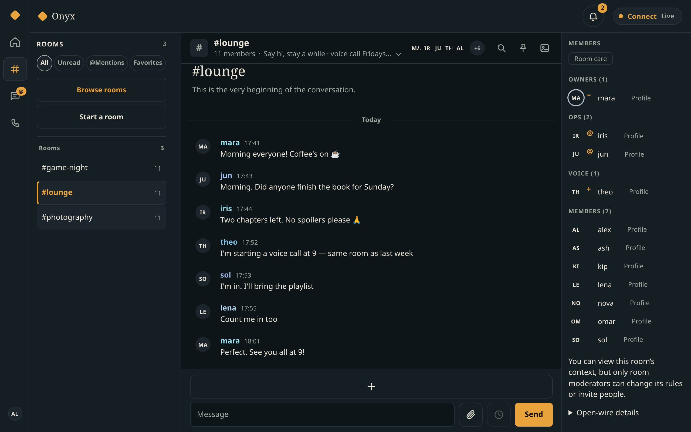
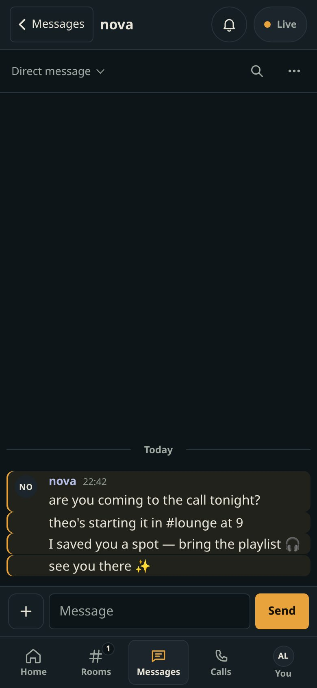
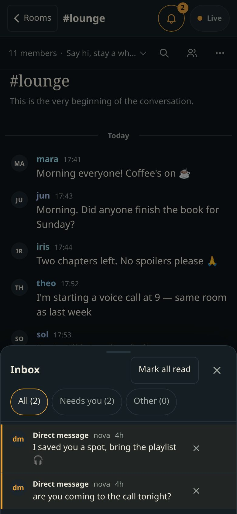

# Onyx

Onyx is a chat app for the open IRC network of the same name. It gives you rooms,
direct messages, voice calls and end-to-end encrypted conversations in the
browser, and you can install it like an app on desktop and phone. Under the hood
it speaks IRCv3 and IRCX to an [Onyx Server](https://github.com/devinkbrown/onyx-server)
over secure WebSocket.

- **Live network:** <https://eshmaki.me>
- **This repository:** the Elm web client and the public product website
- **Daemon:** the separate [Onyx Server](https://github.com/devinkbrown/onyx-server) repository
- **License:** [AGPL-3.0-or-later](LICENSE)

<p align="center">
  
</p>

<p align="center">
  
  
  
</p>

## Features

- **Get in fast.** A connect screen lets you join as a guest, sign in, or create
  an account.
- **Five places.** Home, Rooms, Messages, Calls and You. Desktop has an icon rail
  and a sidebar; phones get a bottom bar and full-screen conversation pages.
- **Conversations.** A room header with topic, member count and details;
  messages grouped by author with day and "new" dividers; replies, reactions,
  edits, deletes, pins, search and shared media; a one-row composer that grows
  as you type.
- **Inbox.** Mentions, DMs, invites and kicks in one sheet. Each row jumps to
  its message.
- **Voice calls** in rooms, with a call bar that follows you around the app.
- **End-to-end encryption.** Encrypted DMs and encrypted rooms between enrolled
  devices. The new device-trust review is pending independent security review.
- **History on your device.** Conversations are kept in the browser's IndexedDB
  (400 messages per conversation by default, adjustable), with on-device search.
- **Looks.** Ocean, Pearl, "match device" (the default), Graphite, Sepia, Mist,
  Plum, High contrast and more, plus custom themes in Appearance. Themes apply
  before first paint and are checked for AA contrast.
- **Installable PWA** that picks up new deploys automatically when it's safe to
  reload (no draft, call or private operation in progress).
- **Advanced** tools under You: local services, recovery, devices and backups.

## Status

Onyx is in active development. Most of the client is implemented and covered by
tests, but formal roadmap acceptance is deliberately strict.

- The [acceptance ledger](docs/elm-roadmap/acceptance-ledger.json) shows 4 of
  53 packages accepted. Acceptance needs receipts bound to a frozen source cut,
  and most recent work doesn't have them yet.
- Encrypted rooms pass an 8-stage two-browser journey against a local Onyx
  Server. Rooms with three or more members and cross-node delivery are unproven.
- Browser evidence comes from Chromium (desktop and phone emulation) and, as an
  opt-in, stock Firefox. Real Safari, iOS and Android device runs are pending.
- Lab source provenance is blocked while Onyx Server is mid-change.

The evidence log, newest first, is [`docs/elm-roadmap/README.md`](docs/elm-roadmap/README.md).

## Quick start

You need Node.js 20+, [pnpm](https://pnpm.io/) (never npm or yarn), the
[Elm 0.19.1](https://github.com/elm/compiler/releases/tag/0.19.1) compiler on
`PATH`, and Chromium for the browser tests. [`elm/README.md`](elm/README.md)
shows how to install Elm and elm-test without touching the app's dependencies.

```bash
git clone https://github.com/devinkbrown/onyx.git
cd onyx
pnpm install
node tools/build-elm-site.mjs /tmp/onyx-site
node tools/serve-dir.mjs /tmp/onyx-site 8080
```

Open <http://127.0.0.1:8080/app/>. With no pin the client probes the public node
list in `elm/src/Nodes.elm`. To use another server, open
`/app/?ws=wss://your.host/ws` (only `wss:` endpoints are accepted). There are no
build-time environment variables. See [`docs/configuration.md`](docs/configuration.md).

> `pnpm build` stages the site into `dist/` (via `tools/build-elm-site.mjs`),
> `pnpm preview` serves `dist/` on port 4173, and `pnpm dev` builds and serves it
> on `http://127.0.0.1:3000` (the desktop host's dev origin).

## Development

| Area | Where |
| --- | --- |
| UI, routing, protocol folds | `elm/src` (`Main.elm` ports, `App.elm` model/update, `View/*`) |
| Private runtime (socket, keys, storage owners) | `elm/runtime` (TypeScript, bundled to `runtime.js`) |
| Browser bridge | `elm/ports.js` |
| Styles | `elm/app.css`, `rail.css`, `convo.css`, `site.css` |
| Service worker | `elm/sw.js` |
| Shared TS (Cadence media, E2EE, IRC parser) | `src/lib` |

Read [`CONTRIBUTING.md`](CONTRIBUTING.md) before opening a pull request.

## Testing

```bash
pnpm exec tsc -p elm/runtime/tsconfig.json --noEmit   # runtime strict typecheck
pnpm typecheck && pnpm lint                          # root TS + ESLint
pnpm test:elm-runtime                                # runtime Vitest
pnpm test                                            # root Vitest (src/, tools/)
(cd elm && elm make src/Main.elm --output /dev/null && elm-test)
node --test elm/*.smoke.mjs                          # ports.js smokes
pnpm test:e2e:elm                                    # Chromium, mock socket
pnpm test:e2e:elm:audit                              # 628-check UI audit
```

The audit runs on Chromium (dark, light, reduced motion) and emulated iPhone 13,
iPhone 13 light and iPhone SE. Add stock Firefox with
`ONYX_FIREFOX_EXECUTABLE=/path/to/firefox`. Local-server labs and performance
runs are described in [`docs/testing-and-release.md`](docs/testing-and-release.md).

## Deployment

`./deploy.sh` is the first-party deploy for eshmaki.me, not a general
installer. It builds `dist/`, checks the service-worker build envelope, backs up
the live tree, syncs it into `out/` (served by nginx), and restores the backup
automatically if the post-sync checks fail. After every deploy:

```bash
node tools/verify-live-shell.mjs https://eshmaki.me
```

A single precache hash mismatch makes the service-worker install fail and
leaves returning visitors on their old build.

To self-host, build with `tools/build-elm-site.mjs` and serve the output as
static files (every route has its own `index.html`; unknown paths get
`404.html`) next to an Onyx Server WebSocket listener.

## Architecture

```
 elm/src (Elm)            elm/ports.js             elm/runtime (TypeScript)
 Main ─ ports ──────────▶ vault, prefs, uploads,   transport-owner (IRC socket)
 App  (pure update)       notifications, media ◀──▶ credentials, identity, sessions
 View/* (all UI)          socket                   private crypto, outbox, owned
                                                   IndexedDB, media, SW lifecycle
                                   │
                                   ▼  wss://
                              Onyx Server (IRCv3 + IRCX, Event Spine, MEDIA)
```

Elm holds no secrets: passwords, tokens and keys stay in the runtime. The full
map is in [`docs/architecture.md`](docs/architecture.md).

## Security

- Wire text is untrusted and rendered as text only.
- Encrypted DMs and rooms fail closed. The vault stores ciphertext, never
  decrypted bodies.
- History is local to the browser profile. It is not a cloud backup.
- Device-trust review for encrypted rooms is new and not yet independently
  reviewed.

Read [`docs/security.md`](docs/security.md) before touching crypto, rendering,
storage or uploads. Report vulnerabilities privately as described in
[`SECURITY.md`](SECURITY.md).

## Documentation

- [`docs/README.md`](docs/README.md): documentation hub
- [`docs/getting-started.md`](docs/getting-started.md), [`docs/features.md`](docs/features.md)
- [`docs/architecture.md`](docs/architecture.md), [`docs/configuration.md`](docs/configuration.md)
- [`docs/testing-and-release.md`](docs/testing-and-release.md), [`docs/security.md`](docs/security.md)
- [`ONYX_SERVER_PROTOCOL.md`](ONYX_SERVER_PROTOCOL.md): client-facing server protocol
- [`ROADMAP.md`](ROADMAP.md), [`CHANGELOG.md`](CHANGELOG.md)

## License

Onyx is free software under the GNU Affero General Public License v3.0 or later.
See [`LICENSE`](LICENSE) and [`NOTICE.md`](NOTICE.md). Third-party packages keep
their own licenses.
